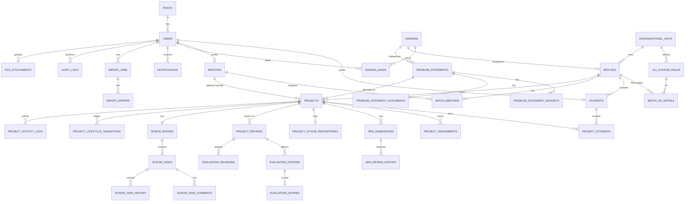

# ICTAKPMS – Architecture (approved design)

```
Browser (React/Vite/Tailwind) ──► nginx (SPA + /api proxy) ──► Flask/gunicorn ──► MySQL 8
```

Backend layering: **routes** (thin: parse, authorise, serialise) → **services** (business rules, transactions)
→ **models**. Cross-cutting: `permissions/` (role + scope guards), `utils/` (envelope, errors, audit).
Storage will sit behind a `StorageBackend` interface (local now, S3-compatible later).

## Decisions
- Individual projects by default; teams optional via `project_students` (1..N).
- Mentor scope is batch-level (`batch_mentors`) with optional per-project override (`projects.mentor_id`).
- Domain leads are many-to-many (`domain_leads`) for co-leads and cross-domain grants.
- Project **stage** (state machine) is separate from the four weekly **reviews** (independent records).
- Progress weights (configurable): SRS 20 · GitHub 5 · Scrum 25 · Reviews 40 · Final sign-off 10.
- API docs: flask-smorest (OpenAPI at `/api/openapi.json`, UI at `/api/docs`).
- Out-of-scope resource access returns 404, not 403.

## ER diagram



Additional tables beyond the original list: `system_settings`, `password_reset_tokens`,
`evaluation_revisions`, `evaluation_templates`, `project_lifecycle_transitions`.
